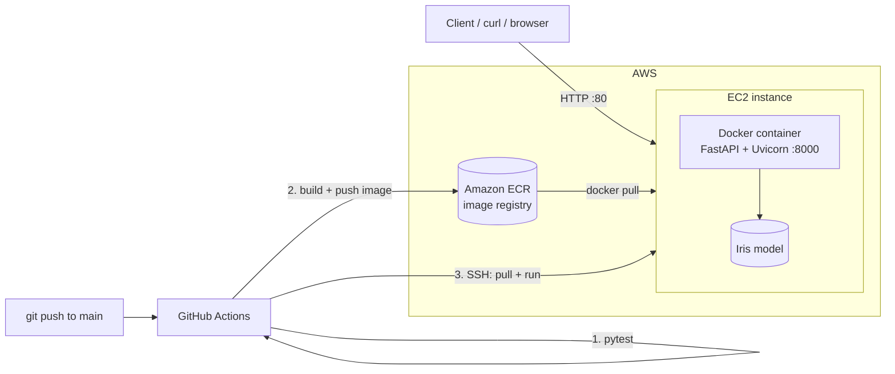

# Iris ML API — ML Model Deployment on AWS

A small end-to-end project: **train a model → serve it as a REST API → containerize with Docker → deploy on AWS EC2 via a GitHub Actions CI/CD pipeline.**

## What I built

- A scikit-learn **RandomForest** classifier trained on the Iris dataset.
- A **FastAPI** service exposing the model (`/predict`, `/health`).
- A **Docker** image (model is trained at build time, so the image is self-contained).
- A **GitHub Actions** pipeline: run tests → build image → push to **Amazon ECR** → deploy to **EC2**.
- 7 automated tests (pytest). Deployment is blocked if any test fails.

## Architecture



**Flow:** the client sends a JSON request to EC2 (port 80), which is mapped to port 8000 of the container. FastAPI validates the input, the model predicts, and JSON is returned.

## API

| Method | Endpoint | Description |
|---|---|---|
| GET | `/health` | Liveness check; shows whether the model is loaded and the container host name |
| POST | `/predict` | Predict the Iris species |
| GET | `/docs` | Interactive Swagger UI |

Example:

```bash
curl -X POST http://<EC2_PUBLIC_IP>/predict \
  -H "Content-Type: application/json" \
  -d '{"sepal_length":5.1,"sepal_width":3.5,"petal_length":1.4,"petal_width":0.2}'
```

Response:

```json
{"prediction":"setosa","confidence":1.0,"probabilities":{"setosa":1.0,"versicolor":0.0,"virginica":0.0}}
```

## Run locally

```bash
pip install -r requirements-dev.txt
pytest -v                                  # run tests
uvicorn app.main:app --reload              # http://localhost:8000/docs
```

With Docker:

```bash
docker build -t iris-ml-api .
docker run -p 8000:8000 iris-ml-api
```

## Tests

`tests/test_api.py` has 7 tests: health check, two correct predictions (setosa, virginica), response format, missing field (422), invalid value (422), and a model-accuracy check (>= 85%).

```bash
pytest -v
```

## CI/CD (GitHub Actions)

File: `.github/workflows/ci.yml`

1. **test** job runs on every push and pull request.
2. **deploy** job has `needs: test`, so it only runs on `main` when tests pass. It builds the image, pushes it to ECR, then SSHes into EC2 and restarts the container.

### Blocking pushes when tests fail

GitHub repo → Settings → Branches → Add rule for `main`:
- Require a pull request before merging
- Require status checks to pass → select **Run tests**

Now code with failing tests cannot be merged into `main`, and deploy never runs.

## Deploy on AWS (one-time setup)

1. **ECR:** create a private repository named `iris-ml-api`.
2. **EC2:** launch an Amazon Linux 2023 `t2.micro`/`t3.micro` instance.
   - Security group: allow inbound **22** (SSH, your IP) and **80** (HTTP, anywhere).
   - Attach an IAM role with `AmazonEC2ContainerRegistryReadOnly`.
3. **Install Docker on EC2:**
   ```bash
   sudo dnf install -y docker
   sudo systemctl enable --now docker
   sudo usermod -aG docker ec2-user
   ```
   (AWS CLI is preinstalled on Amazon Linux 2023.)
4. **GitHub secrets** (Settings → Secrets and variables → Actions):

   | Secret | Value |
   |---|---|
   | `AWS_ACCESS_KEY_ID` / `AWS_SECRET_ACCESS_KEY` | IAM user with ECR push permission |
   | `AWS_REGION` | e.g. `ap-south-1` |
   | `ECR_REPOSITORY` | `iris-ml-api` |
   | `EC2_HOST` | EC2 public IP or DNS |
   | `EC2_SSH_KEY` | contents of your `.pem` private key |

5. Push to `main`. The pipeline deploys automatically. Open `http://<EC2_PUBLIC_IP>/docs`.

## Project structure

```
app/main.py        FastAPI app
app/train.py       model training
tests/test_api.py  pytest tests
Dockerfile         container image
.github/workflows/ci.yml  CI/CD pipeline
```
